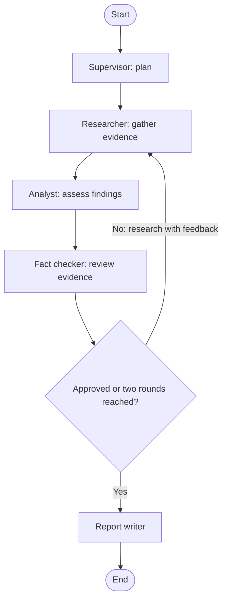

<div align="center">

# ResearchGraph

**A local-first research assistant with a chat interface and a review-driven workflow.**

[](https://www.python.org/)
[](https://github.com/langchain-ai/langgraph)
[](https://streamlit.io/)
[](https://modelcontextprotocol.io/)
[](LICENSE)

Ask a question. Gather evidence. Review the findings. Read the report.

</div>

---

## Overview

ResearchGraph connects a local LLM through an OpenAI-compatible endpoint to your existing MCP server. A LangGraph workflow plans the research, gathers evidence through Deep Agents, analyzes the findings, reviews their completeness, and writes a Markdown report in a Streamlit chat interface.

The workflow can return to research when evidence is insufficient, with a two-round limit to keep the process bounded.

## Features

- **Chat interface** with Markdown reports, session history, follow-up questions, and a new-chat button.
- **Five focused roles**: supervisor, researcher, analyst, fact checker, and report writer.
- **Conditional review loop** that requests additional research before writing the report.
- **MCP tools, including Tavily web search**, loaded from your existing MCP server. No separate Tavily integration is needed in ResearchGraph.
- **Local LLM support** through an OpenAI-compatible Chat Completions endpoint.
- **Workflow progress** showing completed stages while research runs.

## Workflow



The researcher uses Deep Agents with the connected MCP tools. The other roles call the local LLM directly. The fact checker evaluates the supplied findings and citations; it does **not** independently browse or guarantee factual accuracy. Unresolved gaps should be disclosed in the final report.

## Quick start

### 1. Install

Requirements: **Python 3.14+**, **uv**, a running local LLM server, and a running Streamable HTTP MCP server.

```powershell
git clone https://github.com/OmarShemis/researchgraph.git
cd researchgraph
uv sync
Copy-Item .env.example .env
```

For an existing checkout, keep your current `.env` rather than replacing it.

### 2. Configure

Edit `.env` to match your local services:

```dotenv
LOCAL_BASE_URL=http://localhost:1235/v1
LOCAL_MODEL=google/gemma-4-e4b
LOCAL_API_KEY=local
MCP_URL=http://localhost:8000/mcp
```

| Variable | Purpose |
| --- | --- |
| `LOCAL_BASE_URL` | Your local OpenAI-compatible API endpoint, including `/v1`. |
| `LOCAL_MODEL` | Exact model identifier served by that endpoint. Choose a model with tool-calling support. |
| `LOCAL_API_KEY` | Authentication token if required; `local` is a placeholder for servers without authentication. |
| `MCP_URL` | Streamable HTTP endpoint of your existing MCP server. |

Start your local LLM and MCP server before opening the app. Tavily web search is already provided by the MCP server used with this project; ResearchGraph calls it through MCP. Keep its existing Tavily configuration on that server. No Tavily key or SDK setup is needed in ResearchGraph. A cloud model API key is not required when using a local LLM server without authentication.

### 3. Launch

```powershell
uv run streamlit run streamlit_app.py
```

Open **http://localhost:8501**, enter a research question, and follow the stage updates. The report appears in the conversation when the workflow finishes. Follow-up questions include the previous chat as context; **New chat** clears that history.

## Project structure

```text
researchgraph/
├── streamlit_app.py                 # Chat UI and workflow execution
├── .env.example                     # Local service configuration template
├── pyproject.toml
├── uv.lock
└── src/researchgraph/
    ├── config.py                    # Local LLM configuration
    ├── agents/
    │   ├── supervisor.py
    │   ├── researcher.py
    │   ├── analyst.py
    │   ├── fact_checker.py
    │   └── report_writer.py
    ├── graphs/rgraph.py              # Nodes, edges, and conditional routing
    ├── integrations/mcp_client.py    # External MCP connection
    ├── prompts/system_prompts.py
    ├── state/state.py               # Shared workflow state
    └── memory/store.py               # In-memory checkpoints
```

Node functions live in `agents/`; the single graph file registers them and defines the path from start to finish. MCP tools receive an `mcp_` prefix to avoid collisions with built-in Deep Agents tools. Their session stays open throughout each research run.

## Scope and limitations

- Chat history lasts for the current Streamlit session. Checkpoints are in memory; each submitted question starts a fresh graph thread with prior conversation text supplied as context.
- Research is limited to two total rounds. Reaching the limit does not mean that every claim has been verified.
- Model tool-calling quality and the MCP server's available tools affect results. Blocked pages and missing credentials can prevent source access.
- All discovered MCP tools are available to the researcher. Their permissions and side effects are controlled by your MCP server; the application is not a sandbox or a human-approval enforcement layer.
- A local LLM does not imply offline research: web tools can contact external services.

## Troubleshooting

| Symptom | Check |
| --- | --- |
| Cannot connect to the model | Confirm the server is running and `LOCAL_BASE_URL` matches its port. |
| Model not found | Set `LOCAL_MODEL` to an identifier returned by the server's `/v1/models` endpoint. |
| MCP connection fails | Confirm the MCP server is running and its Streamable HTTP URL matches `MCP_URL`. |
| Tool calls fail | Verify that the model supports tool calling and the MCP tools have their required credentials. |

## License

[MIT](LICENSE) · Omar Shemis
